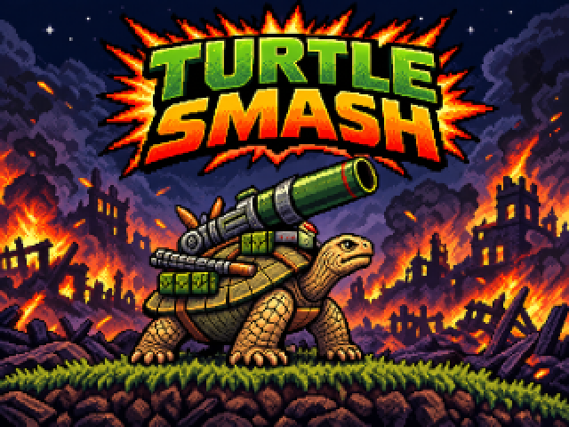
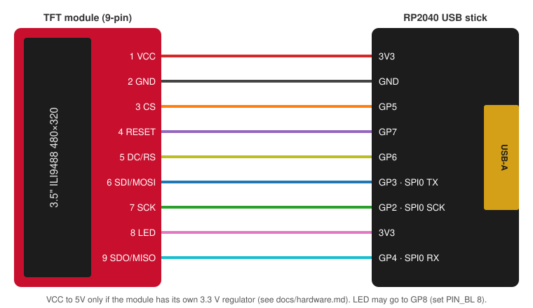
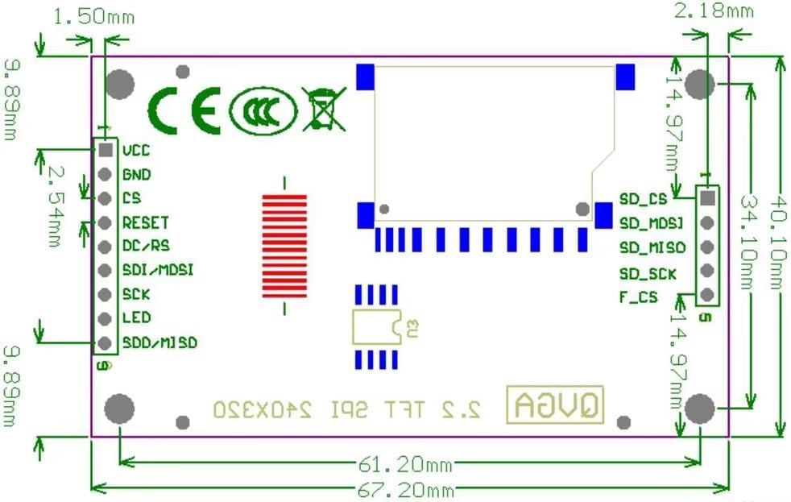
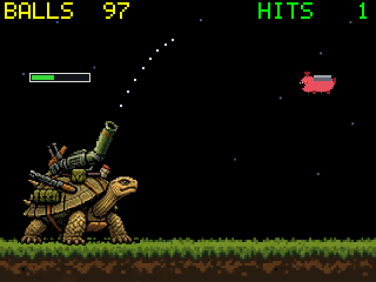

# Turtle Smash

A cannon game for a 2.2" ILI9341 SPI TFT driven by an RP2040 USB stick, written in
C on the Raspberry Pi Pico SDK. An armoured turtle walks the battlefield, aims and
fires a cannon at war-pig drones flying in overhead, with a flicker-free 30 fps
renderer and a title + story intro on power-up. No display library: everything
down to the ILI9341 driver, font and renderer is written from scratch.

<p align="center">
  
</p>

## Features

- Intro sequence: a title card, then a 4-panel story, before the game starts
- Physics-based cannon: aim, charge power, and fire in a gravity arc, with a
  dotted aim guide on the first round
- Menacing war-pig drones that fly in at random height and speed; a hit bursts
  them into pork chunks and they respawn after a pause
- Dirty-rectangle renderer: only the screen areas that changed are recomposited
  and sent over SPI by DMA, for a steady 30 fps on real hardware
- Scoreboard HUD (balls left, hits) and a reset button for a new game
- Host-side test that runs the real renderer and game logic against an emulated
  ILI9341 panel, with no hardware needed

## Hardware

| Part | |
|---|---|
| MCU | Generic "RP2040 USB" stick (RP2040, 4 MB flash, USB-A) — [photo](docs/images/rp2040_board.jpg), [pinout](docs/images/rp2040_pinout.jpg) |
| Display | Red 2.2" SPI TFT, ILI9341, 240×320, 9-pin header + SD card header — [drawing](docs/images/ili9341_back.jpg) |
| Controls | 5 momentary buttons (or a joystick module) to GND: up/down/left/right/centre, plus a reset button |

See [docs/hardware.md](docs/hardware.md) for compatibility, power and backlight notes.

## Controls

| Input | Action |
|---|---|
| UP / DOWN | Aim the barrel (10°–65° above horizontal) |
| LEFT / RIGHT | Walk |
| CENTRE (hold, then release) | Charge power, then fire |
| RESET | Start a new game |

| Button | RP2040 USB stick |
|---|---|
| UP | GP26 |
| DOWN | GP27 |
| LEFT | GP28 |
| RIGHT | GP15 |
| CENTRE | GP14 |
| RESET | GP1 |

Each button switches its GPIO to GND; internal pull-ups are used, so no external
resistors are needed. Pins are set in [`src/config.h`](src/config.h).

## Wiring



| Display pin | Signal | RP2040 USB stick |
|---|---|---|
| 1 | VCC | `3V3` (`5V` only if the module has its own regulator, see [hardware notes](docs/hardware.md#power)) |
| 2 | GND | `GND` |
| 3 | CS | GP5 |
| 4 | RESET | GP7 |
| 5 | DC / RS | GP6 |
| 6 | SDI / MOSI | GP3 (SPI0 TX) |
| 7 | SCK | GP2 (SPI0 SCK) |
| 8 | LED | `3V3` (or GP8 with `PIN_BL 8`) |
| 9 | SDO / MISO | GP4 (SPI0 RX), optional, used only for the status readback |

Pin numbering follows the module's silkscreen (pin 1 = VCC, square pad):

<p align="center">
  
</p>

Keep wires under ~15 cm. The 5-pin SD card header on the right isn't used by this
firmware. The pins are set in [`src/config.h`](src/config.h).

## Building

You need CMake ≥ 3.13, the ARM GCC toolchain and the Pico SDK (2.x):

```sh
sudo apt install cmake gcc-arm-none-eabi libnewlib-arm-none-eabi build-essential git
git clone --recurse-submodules -b 2.3.1 https://github.com/raspberrypi/pico-sdk ~/pico-sdk
export PICO_SDK_PATH=~/pico-sdk
```

Then:

```sh
cmake -B build
cmake --build build -j
```

You can skip the SDK clone and let CMake download it with
`cmake -B build -DPICO_SDK_FETCH_FROM_GIT=1`. On first configure, SDK 2.x also builds
`picotool` if it isn't installed.

To target a Raspberry Pi Pico instead, pass `-DPICO_BOARD=pico` and adjust the pins
in `src/config.h`.

## Flashing

1. Hold **BOOT** and plug the stick into a USB port (or hold **BOOT** and tap **RST**).
2. Copy `build/src/tft_clock.uf2` to the `RPI-RP2` drive that appears.

Or use `picotool load -x build/src/tft_clock.uf2`.

Already running? Open the stick's USB serial port at 1200 baud (e.g.
`stty -F /dev/ttyACM0 1200`) to reboot it straight to the `RPI-RP2` drive, no BOOT
button needed.

## Playing

On power-up you get the title card (3 s), then the 4-panel story (2 s each), then
the game starts. Walk the turtle, aim and hold the centre button to charge a shot
— the longer you hold (up to about 1.3 s), the more power — and release to fire.
War-pigs fly in from the right at a random height and speed; a direct hit bursts
them and they respawn after a short pause. You start with 100 balls; the HUD at
the top shows balls left and hits. Press RESET at any time, including when you run
out of balls, to start a new game.

The first round shows a dotted preview of the shot's arc to help you find the
range; it's hidden after that.

## Testing without hardware

`tests/host` builds the renderer and game logic for your PC against stub SDK
headers and an ILI9341 emulator that interprets the SPI/DMA command stream. It
checks that every frame sent to the panel matches a full composite of the
background and all layers — catching any area that changed on screen without
being marked dirty — and writes PPM screenshots (used for the images in this
README):

```sh
cmake -S tests/host -B build-host
cmake --build build-host
ctest --test-dir build-host --output-on-failure
```

<p align="center">
  
</p>

## Configuration

| Setting | Where | Default |
|---|---|---|
| Pins, SPI instance, SPI clock | `src/config.h` | SPI0 on GP2–GP7, 40 MHz requested |
| Button pins | `src/config.h` | GP26/27/28/15/14/1 |
| Orientation / colour order | `ILI9341_MADCTL` in `lib/ili9341/include/ili9341.h` | `0x28` (landscape, BGR) |
| Cannon angle, power, charge time, recoil | `src/game_config.h` | 10°–65°, 1.3 s to full charge |
| Pig speed, gravity, starting balls | `src/game_config.h` | — |
| Board | `-DPICO_BOARD=...` | `rp2040_usb_stick` (`boards/`) |

The turtle and barrel sprites are generated from `assets/tortoise.png` by
`tools/make_turtle_assets.py`, which also takes an optional scale factor to
resize the sprite (anchored at the feet and left edge). The intro images are
generated from `assets/title.png` and `assets/story.png` by
`tools/make_intro_assets.py`, which auto-detects and crops out the gutter
between the 4 story panels. Re-run either after editing the source art:

```sh
python3 tools/make_turtle_assets.py assets/tortoise.png src/ [scale]
python3 tools/make_intro_assets.py assets/title.png assets/story.png src/
```

## Troubleshooting

| Symptom | Fix |
|---|---|
| White screen only | The backlight works but the panel isn't initialised. Check CS/DC/RESET/SCK/MOSI and a common GND, or try `SPI_BAUD` at 10 MHz. |
| Black screen | No backlight: LED (pin 8) not connected to 3V3. |
| Colours look wrong | Colour order swapped: toggle bit `0x08` in `ILI9341_MADCTL`. For a labelled RED/GREEN/BLUE/WHITE test screen while bringing up a new display, build with `-DSHOW_TORTOISE=0`. |
| Image mirrored or upside down | Set `ILI9341_MADCTL` to `0xE8`. |
| Random pixels / noise | Wires too long or poor ground: lower `SPI_BAUD`. |
| Buttons don't respond | Check each GPIO switches to GND when pressed; pull-ups are enabled in firmware, no external resistors needed. |
| No `/dev/ttyACM0` | Unplug and replug the stick; on Linux, add yourself to the `dialout` group. |

## Project layout

```
├── CMakeLists.txt            top-level firmware build
├── cmake/                    Pico SDK import
├── boards/                   board header for the RP2040 USB stick
├── assets/                   source art for the sprite/intro generators
├── src/                      game logic, renderer, input, display config
├── lib/ili9341/              display driver and 5×7 font
├── tools/                    generators that turn assets/ into src/*.c
├── tests/host/               host build with ILI9341 emulator and SDK stubs
└── docs/                     hardware notes, wiring diagram, images
```

## License

[MIT](LICENSE)
