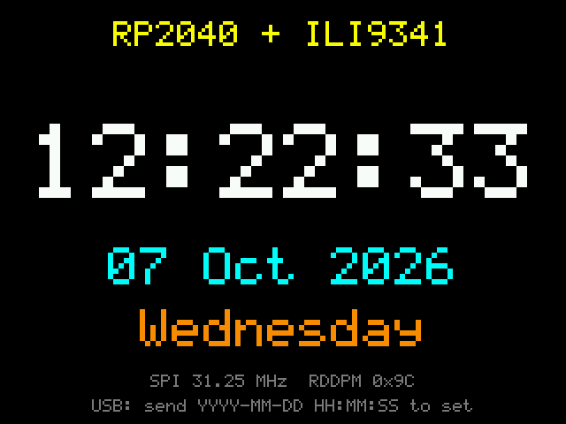

# RP2040 ILI9341 Clock

A digital clock on a 2.2" ILI9341 SPI TFT driven by an RP2040 USB stick, written in C
on the Raspberry Pi Pico SDK. It has a small self-contained display driver, a
power-on colour test and a flicker-free clock (only changed digits are redrawn), and
you set the time over USB serial.

<p align="center">
  
</p>

## Features

- Minimal ILI9341 driver: init, filled rectangles, scaled 5×7 font, register readback
- Power-on colour test (red, green, blue, white, each labelled) to check colour order
- Large `HH:MM:SS` clock with date and day name, driven by the RP2040 hardware RTC
- Set the time from any serial terminal, e.g. `2026-10-07 14:30:00`
- Custom board definition for the 4 MB "RP2040 USB" stick
- Host-side test that runs the firmware against an emulated ILI9341, with no hardware needed

## Hardware

| Part | |
|---|---|
| MCU | Generic "RP2040 USB" stick (RP2040, 4 MB flash, USB-A) — [photo](docs/images/rp2040_board.jpg), [pinout](docs/images/rp2040_pinout.jpg) |
| Display | Red 2.2" SPI TFT, ILI9341, 240×320, 9-pin header + SD card header — [drawing](docs/images/ili9341_back.jpg) |

See [docs/hardware.md](docs/hardware.md) for compatibility, power and backlight notes,
and for Arduino / MicroPython library recommendations.

## Wiring


| Display pin | Signal | RP2040 USB stick |
|---|---|---|
| 1 | VCC | `3V3` (`5V` only if the module has its own regulator, see [hardware notes](docs/hardware.md#power)) |
| 2 | GND | `GND` |
| 3 | CS | GP5 |
| 4 | RESET | GP7 |
| 5 | DC / RS | GP6 |
| 6 | SDI / MOSI | GP3 (SPI0 TX) |
| 7 | SCK | GP2 (SPI0 SCK) |
| 8 | LED | `3V3` (or GP8 with `PIN_BL 8`) |
| 9 | SDO / MISO | GP4 (SPI0 RX), optional, used only for the status readback |

Pin numbering follows the module's silkscreen (pin 1 = VCC, square pad):

<p align="center">
  
</p>

Keep wires under ~15 cm. The 5-pin SD card header on the right isn't used by this
firmware. The pins are set in [`src/config.h`](src/config.h).

## Building

You need CMake ≥ 3.13, the ARM GCC toolchain and the Pico SDK (2.x):

```sh
sudo apt install cmake gcc-arm-none-eabi libnewlib-arm-none-eabi build-essential git
git clone --recurse-submodules -b 2.1.1 https://github.com/raspberrypi/pico-sdk ~/pico-sdk
export PICO_SDK_PATH=~/pico-sdk
```

Then:

```sh
cmake -B build
cmake --build build -j
```

You can skip the SDK clone and let CMake download it with
`cmake -B build -DPICO_SDK_FETCH_FROM_GIT=1`. On first configure, SDK 2.x also builds
`picotool` if it isn't installed.

To target a Raspberry Pi Pico instead, pass `-DPICO_BOARD=pico` and adjust the pins
in `src/config.h`.

## Flashing

1. Hold **BOOT** and plug the stick into a USB port (or hold **BOOT** and tap **RST**).
2. Copy `build/src/tft_clock.uf2` to the `RPI-RP2` drive that appears.

Or use `picotool load -x build/src/tft_clock.uf2`.

## Usage

On power-up you'll see the colour test, then the clock. The RTC has no battery, so
the clock starts from the **firmware build time**. To set it, open the stick's USB
serial port (any baud rate works for USB CDC):

```
$ screen /dev/ttyACM0
2026-10-07 14:30:00        sets the clock
?                          prints the current time
```

Or in one line from Linux: `echo "$(date '+%F %T')" > /dev/ttyACM0`.

The footer shows the actual SPI clock and the panel's `RDDPM` status
(`0x9C` = awake, display on).

## Testing without hardware

`tests/host` builds the firmware for your PC against stub SDK headers and an ILI9341
emulator that interprets the SPI command stream. It checks the init sequence, colour
test, clock rendering, serial time setting (valid and invalid input) and partial
redraws, and writes screenshots as PPM files:

```sh
cmake -S tests/host -B build-host
cmake --build build-host
ctest --test-dir build-host --output-on-failure
```

<p align="center">
  
</p>

## Configuration

| Setting | Where | Default |
|---|---|---|
| Pins, SPI instance, SPI clock | `src/config.h` | SPI0 on GP2–GP7, 40 MHz requested |
| Orientation / colour order | `ILI9341_MADCTL` in `lib/ili9341/include/ili9341.h` | `0x28` (landscape, BGR) |
| Board | `-DPICO_BOARD=...` | `rp2040_usb_stick` (`boards/`) |

## Troubleshooting

| Symptom | Fix |
|---|---|
| White screen only | The backlight works but the panel isn't initialised. Check CS/DC/RESET/SCK/MOSI and a common GND, or try `SPI_BAUD` at 10 MHz. |
| Black screen | No backlight: LED (pin 8) not connected to 3V3. |
| Screen labelled RED shows blue | Colour order swapped: toggle bit `0x08` in `ILI9341_MADCTL`. |
| Text mirrored or upside down | Set `ILI9341_MADCTL` to `0xE8`. |
| Random pixels / noise | Wires too long or poor ground: lower `SPI_BAUD`. |
| `RDDPM 0x00` or `0xFF` | MISO not connected (harmless for drawing). |
| No `/dev/ttyACM0` | Unplug and replug the stick; on Linux, add yourself to the `dialout` group. |

## Project layout

```
├── CMakeLists.txt            top-level firmware build
├── cmake/                    Pico SDK import
├── boards/                   board header for the RP2040 USB stick
├── src/                      application (clock, serial time setting, pin config)
├── lib/ili9341/              display driver and 5×7 font
├── tests/host/               host build with ILI9341 emulator and SDK stubs
└── docs/                     hardware notes, wiring diagram, images
```

## License

[MIT](LICENSE)
