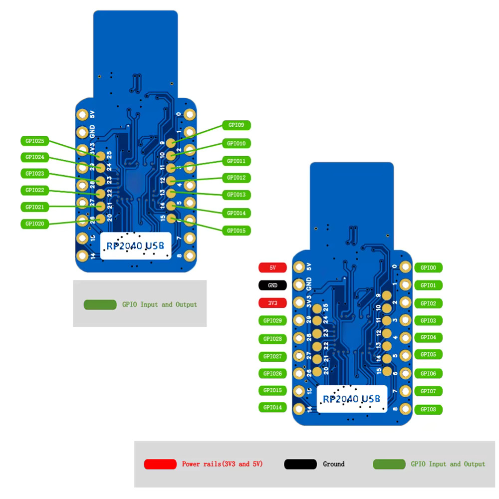

# Hardware notes

## Parts

| Part | Details |
|---|---|
| Display | 3.5" SPI TFT module **MSP3520** (**ILI9488**, 480×320, 9-pin header, touch optional) — [user manual](datasheets/3.5inch_SPI_Module_MSP3520_User_Manual_EN.pdf). The earlier red 2.2" **ILI9341** module is described below. |
| MCU board | Generic **"RP2040 USB" stick**: RP2040-B2, 12 MHz crystal, W25Q32JV 4 MB QSPI flash, USB-A plug, BOOT and RST buttons |

### RP2040 USB stick pinout

| Location | Pins |
|---|---|
| Edge, power side | 5V, GND, 3V3, GP29, GP28, GP27, GP26, GP15, GP14 |
| Edge, GPIO side | GP0 – GP8 |
| Inner pads | GP9 – GP13, GP20 – GP25 |
| Not broken out | GP16 – GP19 |

Because GP16–GP19 (the Pico's usual SPI0 pins) are missing, this project uses SPI0's
alternate pins GP2 (SCK), GP3 (TX/MOSI) and GP4 (RX/MISO), keeping every display
signal on the GP0–GP8 edge.

### 3.5" ILI9488 module (MSP3520)

Pin functions from the [MSP3520 user manual](datasheets/3.5inch_SPI_Module_MSP3520_User_Manual_EN.pdf)
(section 2). The wiring is the same as the 2.2" module below, so the GPIO table in
the README applies unchanged.

| Pin | Name | Function |
|---|---|---|
| 1 | VCC | Supply, 3.3 V to 5 V |
| 2 | GND | Ground |
| 3 | CS | Chip select, active low |
| 4 | RESET | Reset, active low |
| 5 | DC/RS | Data (high) / command (low) select |
| 6 | SDI(MOSI) | SPI data into the panel |
| 7 | SCK | SPI clock |
| 8 | LED | Backlight: high = on; connect to 3.3 V if you don't need dimming |
| 9 | SDO(MISO) | SPI data out of the panel; optional, used only for status reads |

Pins 10–14 are the touch screen (T_CLK, T_CS, T_DIN, T_DO, T_IRQ) and are not used.
The panel takes 18-bit pixels over SPI, so each pixel is sent as three bytes
(`lib/ili9488` packs RGB565 into that format).

### 2.2" ILI9341 module

**Display header (left, 9 pins, 2.54 mm pitch, pin 1 square pad):**

| Pin | Name | Function |
|---|---|---|
| 1 | VCC | Supply (see [Power](#power)) |
| 2 | GND | Ground |
| 3 | CS | ILI9341 chip select, active low |
| 4 | RESET | ILI9341 reset, active low |
| 5 | DC/RS | Data (high) / command (low) select |
| 6 | SDI/MOSI | SPI data into the panel |
| 7 | SCK | SPI clock |
| 8 | LED | Backlight anode supply |
| 9 | SDO/MISO | SPI data out of the panel (register reads only) |

**SD card header (right, 5 pins, pin 1 square pad):**

| Pin | Name | Function |
|---|---|---|
| 1 | SD_CS | microSD card chip select |
| 2 | SD_MOSI | SPI data into the card |
| 3 | SD_MISO | SPI data out of the card |
| 4 | SD_SCK | SPI clock |
| 5 | F_CS | Chip select for the optional SPI flash footprint (U3), usually not fitted |

This firmware doesn't use the SD card. To add it, connect SD_MOSI/SD_MISO/SD_SCK
to the same bus as the display (GP3/GP4/GP2) and give SD_CS its own GPIO (e.g. GP1 or GP8).
Keep both chip selects high when idle so the devices don't fight on MISO.

**Mechanical:**

| Dimension | Value |
|---|---|
| PCB outline | 67.20 × 40.10 mm |
| Mounting holes (centre to centre) | 61.20 × 34.10 mm, one per corner |
| Display header | 1.50 mm from left edge, pin 1 at 9.89 mm from top edge |
| SD header | 2.18 mm from right edge, pin 1 at 14.97 mm from top edge |
| Header pitch | 2.54 mm |

## Compatibility

- **Logic levels match.** The ILI9341 interface is 3.3 V logic and so are the
  RP2040's GPIOs, so they connect directly with no level shifters.
- **RP2040 GPIOs are not 5 V tolerant.** Never drive them with a 5 V signal. The
  display's only output (SDO/MISO) is 3.3 V.
- **Supply.** Power the module from 3.3 V; see [Power](#power) before using 5 V.
- **Backlight (LED, pin 8).** It draws roughly 20–60 mA depending on the module's
  series resistor. Tie it to 3V3. Drive it from a GPIO only if the module has a
  backlight transistor; otherwise add an NPN or MOSFET for PWM dimming.
- **Current budget.** Display plus backlight is ≤ ~80 mA, well within USB and the
  stick's 3V3 LDO.
- **SPI clock (2.2" ILI9341).** Writes are specified at 10 MHz but work at 40 MHz+ in practice.
  Requesting 40 MHz gives 31.25 MHz (125 MHz / 4). Reads must be slow
  (≤ ~6 MHz), so the driver drops to 1 MHz for register reads.
- **SPI clock (3.5" ILI9488).** The 4-wire write cycle is about 66 ns, so the
  firmware requests 15 MHz (12.5 MHz actual with the 125 MHz clock). A full 480×320
  frame is 460 KB at 3 bytes per pixel, so only changed areas are sent each tick.

## Power

**Default: feed VCC (pin 1) from the stick's `3V3` pin.** That is correct whether or
not the module has its own regulator.

The drawing shows no voltage regulator, so check the **front** of your module before
using 5 V:

- **No regulator:** VCC goes straight to the panel. Use **3.3 V only**; 5 V can
  damage it.
- **3.3 V regulator** (a SOT-23 part, often marked `662K`, with a jumper pad **J1**
  next to it): with J1 **open**, VCC can come from the stick's `5V` pin (USB 5 V).
  With J1 **shorted** the regulator is bypassed, so use 3.3 V only. Running 3.3 V into
  VCC with J1 open also works; the panel just sees a little less than 3.3 V.

## Library options

This branch uses its own small Pico SDK driver (`lib/ili9488`). The 2.2" ILI9341
clock build stays on `main`. For other frameworks:

| Framework | Recommendation | Notes |
|---|---|---|
| **Arduino IDE** | **TFT_eSPI** (Bodmer) on the **earlephilhower arduino-pico** core | Fastest option, with RP2040 DMA, smooth fonts and sprites. In `User_Setup.h`: `ILI9341_DRIVER`, `TFT_SCLK 2`, `TFT_MOSI 3`, `TFT_MISO 4`, `TFT_CS 5`, `TFT_DC 6`, `TFT_RST 7`, `SPI_FREQUENCY 40000000`. Board: *Generic RP2040*, 4 MB flash. |
| Arduino (alternative) | **Arduino_GFX** (moononournation) | Pins are set in the sketch rather than a setup header. Adafruit_ILI9341 + Adafruit_GFX also works but is slower. |
| **MicroPython** | **rdagger/micropython-ili9341** (`ili9341.py` + `xglcd_font.py`) | Pure Python, simple and reliable: `SPI(0, baudrate=40_000_000, sck=Pin(2), mosi=Pin(3), miso=Pin(4))`, `cs=Pin(5)`, `dc=Pin(6)`, `rst=Pin(7)`. Redraw only what changes, because full-screen updates are slow. Use the generic RP2040 MicroPython UF2. |
